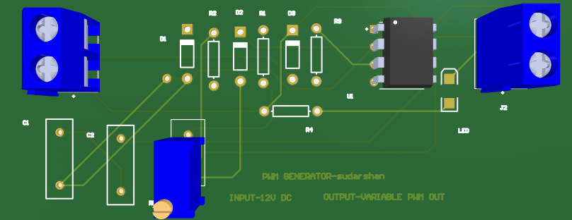
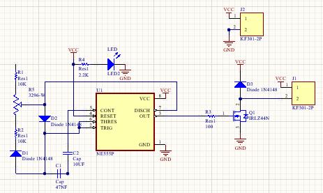
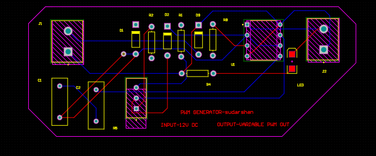

# PWM Generator (NE555 + IRLZ44N) in Altium Designer

A variable duty-cycle PWM generator: a **NE555P** timer sets the pulse width and an **IRLZ44N** logic-level MOSFET drives the load. It runs from a 12 V DC input. The design was done in **Altium Designer 21.0.9**: schematic, two-layer PCB, design rule check (DRC) and fabrication outputs. It follows the tutorial at <https://www.youtube.com/watch?v=Jpn1qe9mA0c>.



## Contents

1. [Design overview](#1-design-overview)
2. [Repository layout](#2-repository-layout)
3. [Getting the project](#3-getting-the-project)
4. [Library setup](#4-library-setup)
5. [Design verification (DRC)](#5-design-verification-drc)
6. [Fabrication outputs](#6-fabrication-outputs)
7. [Connectors](#7-connectors)
8. [Testing](#8-testing)
9. [Possible improvements](#9-possible-improvements)
10. [License](#10-license)

---

## 1. Design overview

### Schematic



The 555 runs as an astable oscillator. Diodes D1 and D2 steer the timing capacitor's charge and discharge current through separate sides of the potentiometer R5, so turning R5 changes the duty cycle while the frequency stays roughly constant. The 555 output (pin 3) drives the gate of Q1 through R3. J1 is the load output, and J2 is the 12 V supply input. An LED with series resistor R4 gives a status indication.

### PCB layout



Two-layer board with top-layer components, red (top) and blue (bottom) routing, and a custom board outline. Silkscreen labels the input (12 V DC) and output (variable PWM).

### Bill of materials

| Designator | Part | Value / note |
|---|---|---|
| U1 | NE555P | Timer IC |
| Q1 | IRLZ44N | N-channel MOSFET, TO-220 |
| R1, R2 | Resistor | 10 kΩ |
| R3 | Resistor | 100 Ω (gate resistor) |
| R4 | Resistor | 2.2 kΩ (LED series resistor) |
| R5 | 3296-W | Trimmer potentiometer (duty-cycle adjust) |
| C1 | Capacitor | 47 nF |
| C2 | Capacitor | 10 µF |
| D1, D2, D3 | 1N4148 | Signal diodes |
| LED | LED | Status indicator |
| J1, J2 | KF301-2P | 2-pin screw terminals |

## 2. Repository layout

```
pwm-generator-altium/
├── README.md
├── images/            schematic, PCB layout and 3D render used in this report
├── altium-project/
│   ├── PWM_schematic.SchDoc               schematic
│   ├── PWM.PcbDoc                         PCB layout
│   ├── IRLZ44N.SchLib                     MOSFET schematic symbol
│   └── IFX-PG-TO220-3-904-1.PcbLib        TO-220 footprint
├── libraries/
│   ├── NE555P.IntLib                      555 timer
│   ├── 3296-W.IntLib                      trimmer potentiometer
│   └── KF301-2P.IntLib                    2-pin screw terminal
└── fabrication/       Gerber and drill files, BOM (add after generating them)
```

## 3. Getting the project

**With Git**

```bash
git clone https://github.com/Sudarshan-veera/pwm-generator-altium.git
cd pwm-generator-altium
```

**As a ZIP**

1. On the repository page, choose **Code → Download ZIP**.
2. Right-click the ZIP and choose **Extract All** to a permanent folder. Don't open files from inside the ZIP.

**Open in Altium Designer**

1. Open Altium Designer and choose **File → Open**, then select `altium-project/PWM_schematic.SchDoc` and `altium-project/PWM.PcbDoc`.
2. To make a project, right-click in the **Projects** panel and choose **Add New Project → PCB Project**, then right-click the project and choose **Add Existing to Project** for both documents.
3. Install the libraries in the next section so the components resolve, then run **Design → Update PCB Document**.

## 4. Library setup

The design uses the standard **Miscellaneous Devices.IntLib** and **Miscellaneous Connectors.IntLib**, which normally ship with Altium Designer. Check the library dropdown in the **Components** panel first. If either is missing:

1. Download Altium's default library package from the official Altium website (search "Download Altium Libraries"). The archive contains both files.
2. Extract it to a permanent folder, for example `Documents\Altium_Libraries`.
3. In Altium, open the **Components** panel, click the menu icon and choose **File-based Libraries Preferences**.
4. On the **Installed** tab, click **Install** and select both `.IntLib` files.
5. Confirm both appear in the library dropdown.

Then install the project libraries from this repo the same way (**Install**, then select the file): `libraries/NE555P.IntLib`, `libraries/3296-W.IntLib`, `libraries/KF301-2P.IntLib`. `IRLZ44N.SchLib` and `IFX-PG-TO220-3-904-1.PcbLib` in `altium-project/` can be added with **Add Existing to Project**.

## 5. Design verification (DRC)

Run the check from the PCB editor: **Tools → Design Rule Check → Run Design Rule Check**. The final board passes with **0 violations**. Three issues came up on the way and were resolved as follows.

| Violation | Cause | Fix |
|---|---|---|
| Silk To Solder Mask Clearance (8 violations on R1–R4 pads) | Resistor silkscreen came within 9.491 mil of the mask opening; the rule required 10 mil | Relaxed the rule to 5 mil under **Design → Rules → Manufacturing → Silk To Solder Mask Clearance**, within typical fab limits. Alternatively, shorten the silk lines in the `AXIAL-0.3` footprint. |
| Unannotated designators (`U?`, `R?`) | Parts had never been annotated in the schematic | In the schematic editor: **Tools → Annotation → Annotate Schematics Quietly**, then **Design → Update PCB Document** |
| Room Definition (parts outside room `PWM_schematic`) | Altium auto-generated a room on the PCB update | Deleted the room under **Design → Rooms**, and turned off room generation in **Project → Project Options → Class Generation** |

## 6. Fabrication outputs

1. Save everything: **File → Save All**.
2. Review the board in 3D (press `3` in the PCB editor) and check **Reports → Board Information**.
3. Compare trace width, clearance, drill size, annular ring and silk-to-mask values against your fab's published minimums.
4. **File → Fabrication Outputs → Gerber Files** (inches, 2:5 format; include the copper, overlay, solder mask, paste and mechanical layers used).
5. **File → Fabrication Outputs → NC Drill Files**.
6. Optional: **File → Assembly Outputs → Pick and Place Files**, and **Reports → Bill of Materials**.
7. Zip the Gerber and drill files into `fabrication/` and check them in the fab's online viewer before ordering.

## 7. Connectors

| Connector | Pin | Function |
|---|---|---|
| J2 | 1 | +12 V supply (VCC) |
| J2 | 2 | Ground |
| J1 | 1 | +12 V (VCC) for the load |
| J1 | 2 | MOSFET drain: load return, switched by the PWM signal |

D3 across the load is a flyback diode. The load is switched on the low side, so connect it between J1 pin 1 and J1 pin 2.

## 8. Testing

To measure the output:

1. Connect a 12 V DC supply to J2, with a resistive or LED load on J1.
2. Probe the gate of Q1 (or the 555 output, pin 3) with an oscilloscope, grounding the probe at J2 pin 2.
3. Turn the trimmer R5 from one end to the other and record the frequency, the minimum and maximum duty cycle and the output voltage swing.
4. Save scope captures to `docs/` and link them here.

## 9. Possible improvements

- Add a decoupling capacitor across the 555 supply pins and a bulk capacitor on the 12 V input.
- Add a pull-down resistor on the MOSFET gate so the load stays off while the 555 starts up.
- Add mounting holes and test points for the PWM output.
- Add reverse-polarity protection on the supply input.

## 10. License

Released under the [MIT License](LICENSE).

## Credits

Tutorial: <https://www.youtube.com/watch?v=Jpn1qe9mA0c> · Designed in Altium Designer 21.0.9.
